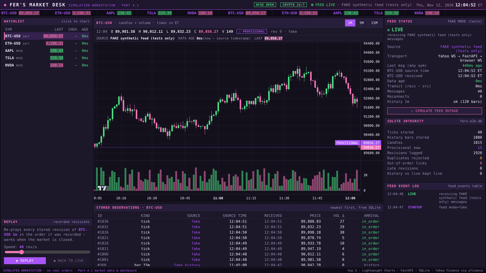

# Fer's Market Desk — Live Market Workstation (IST 402, Assignment 4)

A local market workstation: **Yahoo Finance live stream → FastAPI → SQLite → WebSocket → Vue + Lightweight Charts**.
Part 4.1 delivers the live dashboard (candles and volume), persistence of every observation and candle revision, and replay. It also shows the data source, the data age, and the feed status, including when the feed is down.

> All trading in this project is **simulated**. Part 4.1 places no orders at all.



## What you see

| Area | What it shows |
|---|---|
| Top bar | App name, **NYSE session** (open / pre / after-hours / closed, ET), *CRYPTO 24/7*, **feed badge**, ET clock |
| Ticker tape | Scrolling last price and change % for every symbol; it flashes green or pink when the price changes |
| Watchlist | BTC-USD, ETH-USD, AAPL, TSLA, NVDA with their last price, change % and **data age**. Click a row to chart that symbol |
| Chart | Candlesticks plus a volume pane, with a **1m / 5m / 15m** selector. The forming candle has a faded body, a dashed purple **PROVISIONAL** price line and a `◌ PROVISIONAL` tag; finished candles show `✓ COMPLETE`. The legend shows OHLCV, the revision number and the source |
| Feed status | State (LIVE / CONNECTED / CONNECTING / STALE / UNAVAILABLE), source, last-message age, source vs. receipt time, reconnect count, and the **Simulate feed outage** button |
| SQLite integrity | Counts of ticks, bars, candles, provisional candles, revisions, **duplicates rejected**, **out-of-order ticks** and **late revisions** |
| Stored observations | The newest rows from the `observations` table, with source time, receipt time and arrival classification |
| Feed event log | Rows from the `feed_events` table: every connect, failure, retry and stale period |
| Replay | Re-plays every stored candle revision of the selected pair, in the order it was recorded. It works when the market is closed |

## Requirements

* **Python 3.10+** (`python3 --version`)
* **Node.js 20.19+** (`node --version`) — needed by Vite 8
* Internet access to Yahoo Finance. **No API keys or credentials are needed**, and none are stored in this repository.

## Quick start

Mac / Linux:
```bash
git clone https://github.com/ferrgarzaa/fers-market-desk.git
cd fers-market-desk
./start.sh
```
Windows (PowerShell):
```powershell
git clone https://github.com/ferrgarzaa/fers-market-desk.git
cd fers-market-desk
powershell -ExecutionPolicy Bypass -File .\start.ps1
```
Then open **http://localhost:5173**.

### Manual start (two terminals)
```bash
# terminal 1 — backend
cd backend
python3 -m venv .venv
source .venv/bin/activate            # Windows: .venv\Scripts\activate
pip install -r requirements-dev.txt
python -m uvicorn app.main:app --port 8000

# terminal 2 — frontend
cd frontend
npm install
npm run dev                          # http://localhost:5173
```

### Database initialization
No separate step is needed. On startup, `app/db.py` creates `backend/data/market.db` if it is missing and applies the schema with `CREATE TABLE IF NOT EXISTS`. To start fresh, stop the backend and delete `backend/data/`. To use another file, set `DB_PATH=/path/to/file.db`. The schema is described in [docs/SCHEMA.md](docs/SCHEMA.md).

### Configuration (environment variables, all optional)
| Variable | Default | Meaning |
|---|---|---|
| `SYMBOLS` | `BTC-USD,ETH-USD,AAPL,TSLA,NVDA` | Symbols to subscribe to |
| `FEED_MODE` | `yahoo` | `yahoo` = live source; `fake` = synthetic ticks **for tests only** (labelled FAKE in the UI) |
| `DB_PATH` | `backend/data/market.db` | SQLite file |
| `STALE_AFTER_S` | `30` | Seconds of silence before a connected feed is reported STALE |
| `FINALIZE_GRACE_S` | `3` | Seconds after an interval ends before its candle is marked complete |
| `YAHOO_WS_URL` | Yahoo's streamer | Set it to a bad URL (e.g. `ws://127.0.0.1:9`) to reproduce a **real** unavailable feed |
| `BACKFILL` | `1` | Load recent history bars from Yahoo on startup |

## Demonstrating the unavailable feed
1. **Operator toggle:** click **⚠ Simulate feed outage** in the Feed status panel. The backend closes the Yahoo socket, the state becomes UNAVAILABLE, a pink banner appears over the chart, ticks stop being stored, and an event is logged. Click again to reconnect.
2. **Real network failure:** start the backend with `YAHOO_WS_URL=ws://127.0.0.1:9`, or disconnect Wi-Fi. The feed reports `UNAVAILABLE`, shows the real error text, and retries with exponential backoff. See [docs/evidence/real-unavailable-feed.png](docs/evidence/real-unavailable-feed.png), captured when the network blocked Yahoo.
3. **Backend down:** stop uvicorn. The top bar shows `BACKEND OFFLINE`, and the browser reconnects automatically when the backend comes back.

## Tests
```bash
cd backend && python -m pytest -v                              # 22 unit + API tests
cd frontend && npx playwright install chromium && npx playwright test   # browser test (fake feed)
```
GitHub Actions runs both suites on every push ([.github/workflows/ci.yml](.github/workflows/ci.yml)). The details are in [docs/VERIFICATION.md](docs/VERIFICATION.md).

## Documents
* [docs/DATA_FLOW.md](docs/DATA_FLOW.md) — the path from Yahoo to the chart, and the handling of duplicates, revisions and out-of-order data
* [docs/SCHEMA.md](docs/SCHEMA.md) — the SQLite schema
* [docs/DESIGN.md](docs/DESIGN.md) — design decisions and UI choices
* [docs/VERIFICATION.md](docs/VERIFICATION.md) — what was tested and how
* [AGENTS.md](AGENTS.md) — instructions for coding agents working on this repo
* [AI-USE.md](AI-USE.md) — tool and model disclosure
* [EVIDENCE-LOG.md](EVIDENCE-LOG.md) — curated evidence log
* [report.md](report.md) — Part 4.1 submission report

## Known limitations
See the *Remaining limitations* section in [report.md](report.md). In short: Yahoo's stream is unofficial and only sends a message when a quote changes. Per-candle volume is derived from cumulative counters and is approximate. NYSE holidays are not modelled.
