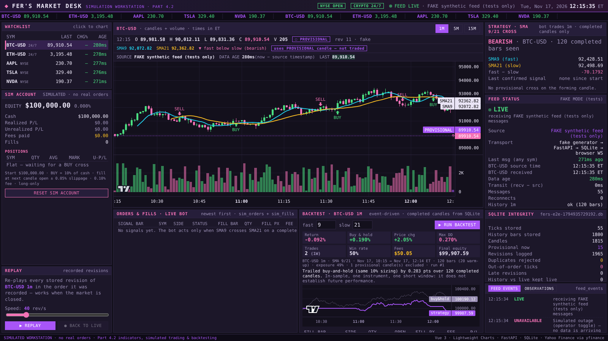

# Assignment 4.2 — Indicators, Simulated Trading, and Backtesting

**Student:** Fernanda Garza Martínez ([ferrgarzaa](https://github.com/ferrgarzaa)) · IST 402
**Application:** *Fer's Market Desk* — continued from Part 4.1 ([4.1 report](docs/reports/report-4.1.md))

| | |
|---|---|
| **GitHub repository** | https://github.com/ferrgarzaa/fers-market-desk |
| **Submitted commit** | `COMMIT_SHA` — https://github.com/ferrgarzaa/fers-market-desk/commit/COMMIT_SHA |
| **Demo video (42 s)** | https://github.com/ferrgarzaa/fers-market-desk/blob/main/docs/demo/fers-market-desk-4.2-demo.mp4 (click *View raw* / download to play) |
| **CI (GitHub Actions)** | https://github.com/ferrgarzaa/fers-market-desk/actions |
| **Strategy & assumptions** | [docs/STRATEGY.md](docs/STRATEGY.md) |

---

## 1. What was completed

**Indicators**
* The chart shows **SMA 9** (cyan) and **SMA 21** (amber) for every symbol and every interval (1m, 5m, 15m).
* A crossover confirmed on a **completed** candle appears as a green ▲ **BUY** or pink ▼ **SELL** arrow.
* A cross that exists only on the **forming** candle appears as a purple ● **`BUY?`/`SELL?` (provisional)** circle, with a faded SMA point, and the legend says *"uses PROVISIONAL candle — not traded"*. The *Strategy* panel shows the SMA values, the bullish or bearish state, the last confirmed signal and a dashed **PROVISIONAL** warning.
* The crossover rule remembers the sign of the last non-zero (SMA9 − SMA21). Crossing from negative to positive is a BUY, the opposite is a SELL, and a touch at exactly 0 is not a cross ([STRATEGY.md §1](docs/STRATEGY.md)).

**Simulated trading and accounting**
* A **live bot** applies the SMA 9/21 crossover to **completed 1-minute candles** of BTC-USD, ETH-USD, AAPL, TSLA and NVDA. It is primed from the stored history at startup, so the SMAs are ready immediately.
* Every signal becomes an order row in SQLite: **pending → filled**, or **skipped** with the reason (already long, no position to sell, already pending).
* Fills are stored with the fill candle, the reference open, the fill price after slippage, the quantity, the fee, the realized P/L and the cash afterwards.
* The *Sim account* panel shows equity, cash, **realized and unrealized P/L**, fees and **positions** (quantity, average cost, mark, unrealized P/L). The *Orders & fills* table shows the trade history, and a pop-up appears for each order or fill. A reset button restarts the account.
* **Documented execution assumptions** ([STRATEGY.md §2](docs/STRATEGY.md)): $100,000 start; each BUY spends 10% of cash including the fee; long-only; the signal comes from the close and the **fill happens at the next candle's open**; 0.05% slippage against us; 0.10% commission on both legs; the buy fee is included in the cost basis; fractional quantities are allowed. Margin, shorts and partial fills are not modelled.

**Backtesting**
* An **event-driven** backtester runs over the stored **completed** candles of the selected symbol and interval (Yahoo history backfill of up to 2,000 bars, plus live-recorded candles). Provisional candles are excluded, and their count is reported.
* At each bar it fills earlier orders at the open, then reveals the close to the strategy, then marks the account. A decision at bar *i* can therefore use only closes up to *i*, and it executes at bar *i+1*.
* It uses **the same detector and broker as the live bot**.
* The *Backtest* panel shows the return, a **buy-and-hold benchmark with the same 10% sizing and costs**, the raw price change, maximum drawdown, round trips and win rate, fees, exposure, final equity, an **equity curve against the benchmark**, and the trade list. Every run is saved in `backtest_runs`.

**Demo video contents** (captured from the app running on my laptop with live Yahoo data, Nov 17 2026 12:37–12:38 ET): SMA 9/21 lines with BUY/SELL markers and the BEARISH strategy state → the provisional-candle label → the sim account and skipped orders → a backtest of BTC-USD 1m (metrics, equity curve against buy-and-hold, trade list with next-open fills) → a verification summary → the design decision. The video was assembled from screenshots taken while the app ran, with captions added. No live BUY cross happened during the recording (all five symbols were bearish), so the live fill shown in §3 comes from the fake-feed run.

**Backtest result on Yahoo data** (run in the app on my laptop):

Run on Tue Nov 17 2026 at about 12:37 ET, on the completed candles stored by my laptop: the Yahoo history backfill plus the 4.1 and 4.2 live sessions. All runs use SMA 9/21, $100,000, 10% sizing, 0.10% fee and 0.05% slippage. The runs are saved in `backtest_runs` (#1–#6).

| Run | Symbol · interval | Completed bars | Period (UTC) | Strategy | Buy & hold (same 10%) | Price change | Max DD | Round trips (wins) | Fees |
|---|---|---|---|---|---|---|---|---|---|
| #1 | **BTC-USD · 1m** | 1,465 | Nov 12 13:44 → Nov 17 17:36 | **−1.21%** | −1.24% | −12.27% | 1.21% | 37 (3) | $734.64 |
| #2 | BTC-USD · 5m | 1,765 | Nov 11 11:05 → Nov 17 17:30 | −2.10% | −1.41% | −14.00% | 2.16% | 47 (4) | $928.30 |
| #3 | ETH-USD · 1m | 1,509 | Nov 12 12:59 → Nov 17 17:36 | −2.35% | −1.20% | −11.89% | 2.35% | 41 (4) | $807.15 |
| #4 | AAPL · 1m | 549 | Nov 12 14:30 → Nov 17 17:36 | −0.59% | −0.20% | −1.84% | 0.61% | 16 (0) | $318.60 |
| #5 | NVDA · 5m | 583 | Nov 6 14:30 → Nov 17 17:30 | −1.44% | −1.95% | −19.35% | 1.56% | 12 (2) | $245.86 |
| #6 | TSLA · 15m | 194 | Nov 6 14:30 → Nov 17 17:15 | −0.57% | +0.90% | +9.18% | 0.95% | 5 (1) | $109.37 |

In each run, one provisional candle was excluded. NVDA 5m ended with one order still pending (its fill bar did not exist yet).

**Interpretation.** Over this short window, the crossover lost money on all six series. It beat the equally sized buy-and-hold only on BTC 1m (by 0.03 points) and NVDA 5m (by 0.51 points), and in both cases only because it spent about 40% of the time out of a falling market. It **lagged** buy-and-hold on TSLA, the one series that rose. Win rates were low (0–20%). Many short crossovers reversed within minutes (whipsaw), and the **commissions alone explain most of the loss**: $734.64 of the $1,213.08 loss on BTC 1m (61%), and $928.30 of $2,104 on BTC 5m. This matches the known weakness of a fast moving-average crossover on noisy intraday data. These numbers describe this sample only (see §4). The 1m series also contain a gap from Nov 12 to Nov 17, while the app was not running, and the SMA treats the bars on either side of it as consecutive.

## 2. Key design decisions
1. **One rule set, two drivers.** The live bot and the backtest share `CrossoverDetector` and `SimBroker`, and a test proves they make **identical fills** on the same candles ([evidence #10](EVIDENCE-LOG.md)).
2. **Event-driven backtest** instead of vectorized arrays, so "only information available at that moment" is built into the loop rather than left to discipline.
3. **Signal at the close, fill at the next open.** Filling at the signal close would use a price that was already gone when the signal existed ([evidence #9](EVIDENCE-LOG.md)).
4. **Completed candles only for trading.** The provisional cross is displayed but never executed. Late revisions do not rewrite decisions already taken.
5. **Every signal leaves a row**, including skipped ones, with the reason.
6. **Realistic friction by default**, and a **fairly sized benchmark** (the same 10% allocation), so the strategy is not flattered.
7. SMA 9/21 was **fixed before seeing any result**, to avoid overfitting. The panel allows other windows, but choosing a window after seeing results would be in-sample tuning.

## 3. Verification results
* **52/52 backend tests pass** (22 from 4.1 plus 30 new); [table](docs/VERIFICATION.md):
  * **Trusted reference:** SMA equals **pandas `rolling(n).mean()`** for n = 1, 2, 9, 21, 50 (tolerance 1e-9). A hand-worked SMA and crossover example is also checked ([STRATEGY.md](docs/STRATEGY.md)).
  * **Batch vs. incremental:** rolling SMA = batch SMA over 2,000 bars, and incremental signals = batch signals over 5,000 bars.
  * **Unfinished candles:** the provisional point is flagged, its peek does not alter state, and the backtest excludes the provisional candle.
  * **Accounting against known examples:** a no-cost round trip gives exactly +$1,000. With costs, cash is exactly $90,000 after the buy and the realized P/L is +$967.05 (hand-computed). The identity *equity − start = realized + unrealized* holds after every one of 400 random trading steps.
  * **No look-ahead:** a run on the first *k* bars makes the same decisions as the first part of the full run (k = 60, 150, 333, 480), and changing future prices never changes earlier decisions.
  * **Live bot = backtest** on the same 500 candles.
* **Browser tests (Playwright): 2/2 pass.** The 4.1 path still works, and the 4.2 test checks the SMA legend, the primed strategy state, the account panel and a full backtest run (metrics, trades, equity canvas).
* **GitHub Actions** runs pytest, the frontend build and Playwright on every push.
* **Live observation (fake feed, local):** TSLA crossed on the 17:16 candle → *pending* → filled at the **17:17 open**, 330.5389 × 1.0005 = 330.7042, fee $9.99, cash $90,000.00. An AAPL SELL was recorded as *skipped — no position to sell*.
* **Live observation (Yahoo, my laptop, Nov 17):** after `git pull`, the bot primed itself on 1,465 stored BTC-USD 1m candles and reported the state BEARISH (SMA9 63,663.03 < SMA21 63,767.97). Candles left *provisional* when the app was closed on Nov 12 were finalized by the clock on startup. Their SELL crosses were recorded as **skipped — no position to sell**, which showed the skip bookkeeping working on real data.
* **Mocked vs. live:** the unit, API and browser tests use synthetic data or the labelled fake feed. The backtests above and the video use **live Yahoo data** on my laptop.

## 4. What the backtest establishes — and what it leaves uncertain
* **Establishes:** what these exact rules would have done on these exact stored candles, under the stated costs and fill model, without using future information. This is shown by construction and by tests.
* **Leaves uncertain:**
  * **Future performance.** A historical result does not establish it.
  * **Sample size.** The windows are short (hours to a few days of 1m/5m/15m bars) and contain few trades, which is not statistically meaningful.
  * **Survivorship bias.** The five instruments were chosen today because they exist and are popular.
  * **Regime.** The result reflects one market regime only.
  * **Gaps.** For stocks, overnight and weekend gaps are treated as consecutive bars.
  * **Fill model.** A fixed slippage replaces a real spread and order-book depth.

## 5. Remaining limitations
* The model is long-only, with no shorting or margin. Fractional shares are a simplification for stocks.
* The live bot trades 1m candles only. Signals on the 5m and 15m charts are shown for analysis but not traded live.
* After a restart, candles that were still forming when the app closed are finalized late, and their signals are evaluated at that moment. This was observed on Nov 17 as two skipped SELLs dated Nov 12. A stale BUY would be filled at the next available candle, possibly days later. A future fix is to skip signals from candles that completed long after they ended.
* The live account persists in SQLite across restarts. A pending order survives a restart and fills at the next candle that arrives, which after a long gap may be much later.
* Decisions are never revised after late data. That is intentional, but a late tick can make a stored candle differ slightly from the one the decision saw (the revision history keeps both).
* The backtest uses only the history stored locally (the Yahoo backfill limits apply: about 1 day of 1m bars and 5 days of 5m/15m bars).
* Part 4.3 will add the AI decision API, the chatbot, vision and live audio.
